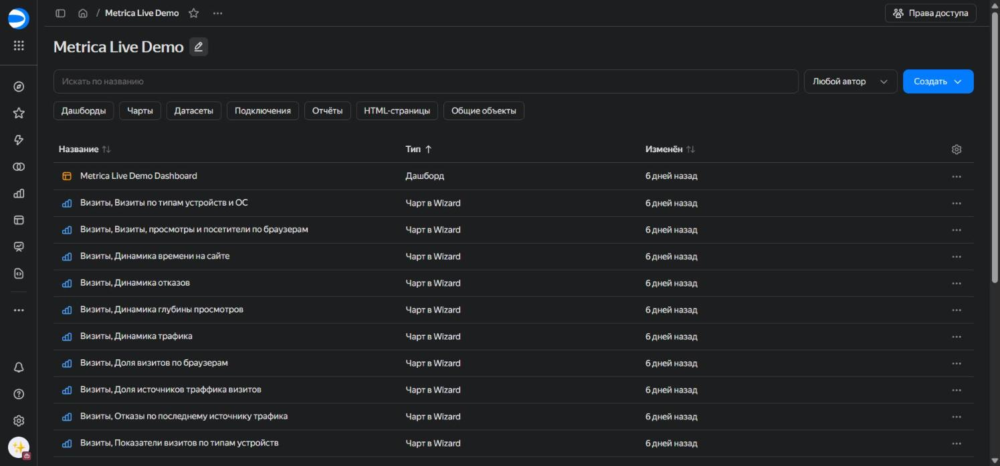
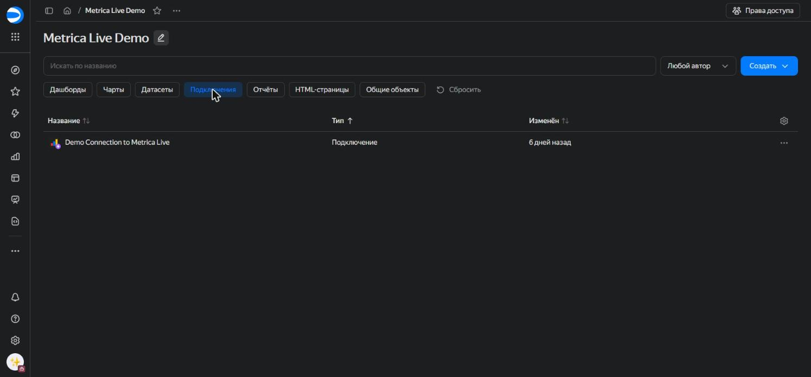
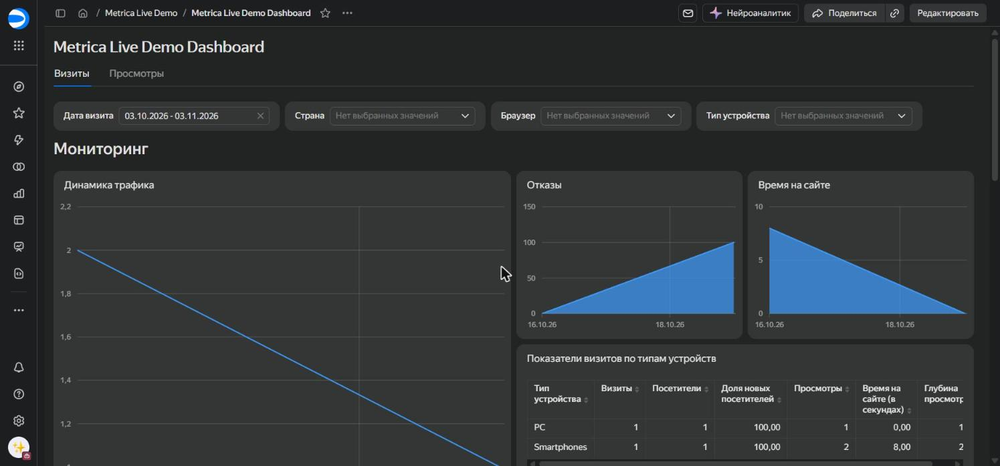
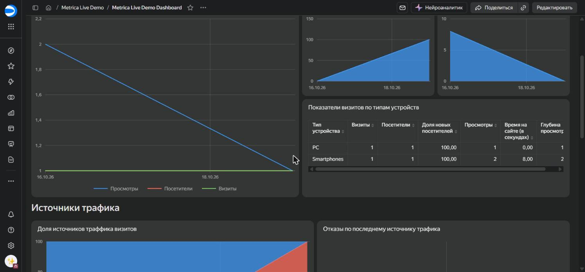
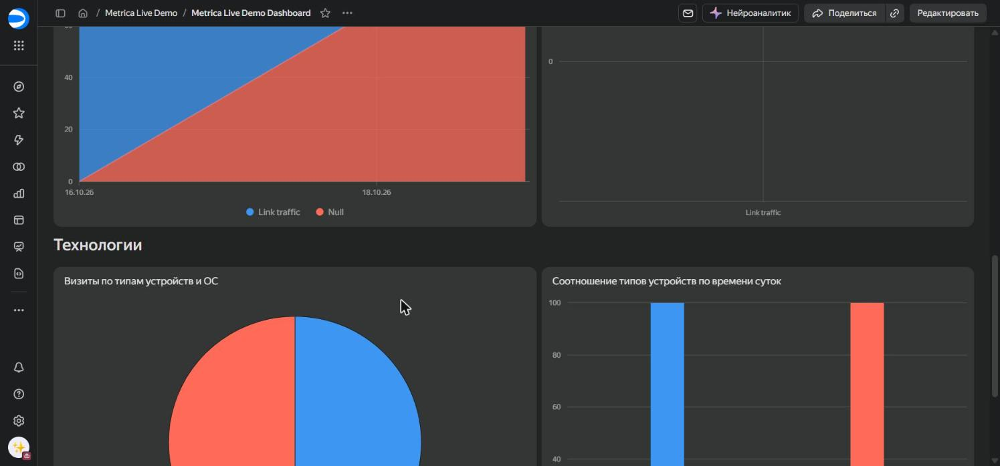
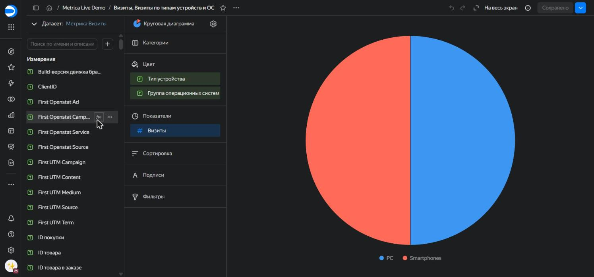
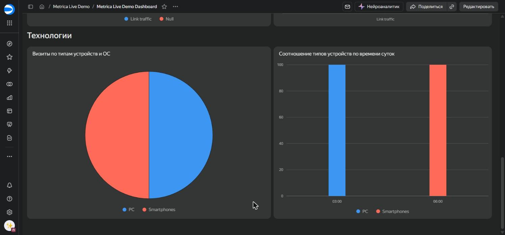
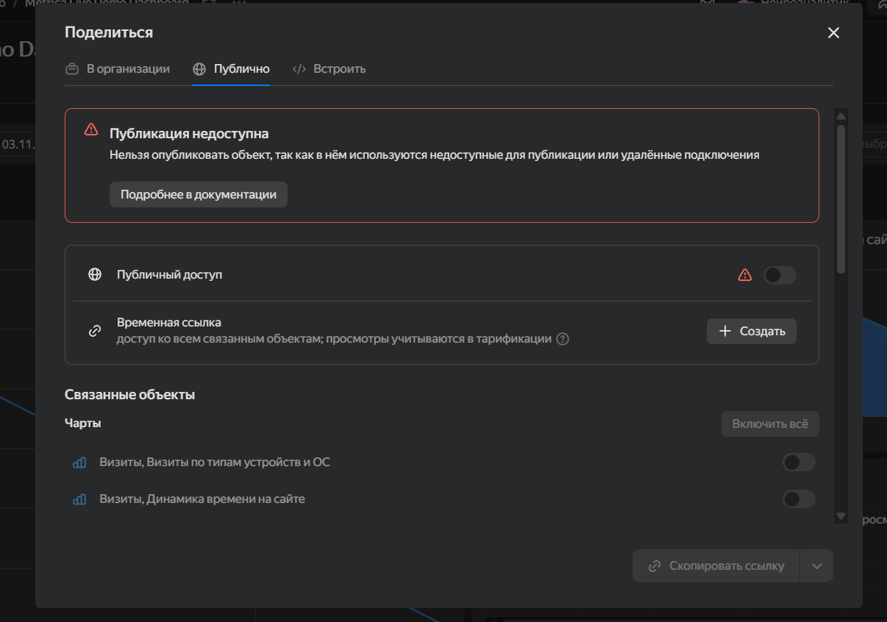

# Лабораторная работа 7

## Яндекс Метрика: прямое подключение

**Сервис:** Yandex DataLens

**Источник данных:** демонстрационный дашборд Яндекс Метрики из DataLens Marketplace

## Цель работы

Познакомиться с работой Yandex DataLens и Яндекс Метрики в режиме прямого доступа: развернуть стандартный дашборд и настроить его, убрав лишние чарты и изменив расположение и тип визуализации.

## Ход работы

### 1. Создание воркбука

Создан воркбук `Metrica Live Demo`. В нём хранятся все объекты работы: дашборд, чарты, датасеты и подключение.

### 2. Развёртывание стандартного дашборда из Marketplace

Задание разрешает использовать демонстрационный дашборд, если нет прав на счётчик Яндекс Метрики, поэтому дашборд развёрнут из DataLens Marketplace. В воркбуке появились подключение `Demo Connection to Metrica Live`, дашборд `Metrica Live Demo Dashboard`, набор чартов и датасеты «Метрика Визиты» и «Метрика Просмотры».

### 3. Изменение стандартного дашборда

На вкладке «Визиты» выполнено:

1. Удалён чарт «Глубина просмотров».
2. Чарты «Отказы» и «Время на сайте» размещены на освободившемся месте, справа от чарта «Динамика трафика».
3. Удалены чарты «Доля визитов по браузерам» и «Визиты, просмотры и посетители по браузерам».
4. Изменения дашборда сохранены.

### 4. Изменение чарта

Тип чарта «Визиты по типам устройств и ОС» изменён на «Круговая диаграмма», чарт сохранён.

После обновления дашборда чарт в разделе «Технологии» отображается как круговая диаграмма.

## Результат

| Шаг задания | Статус |
|---|---|
| Создан воркбук `Metrica Live Demo` | Выполнено |
| Стандартный дашборд с подключением `Demo Connection to Metrica Live` развёрнут из Marketplace | Выполнено |
| Удалён чарт «Глубина просмотров» | Выполнено |
| Чарты «Отказы» и «Время на сайте» заполнили освободившееся место | Выполнено |
| Удалены чарты «Доля визитов по браузерам» и «Визиты, просмотры и посетители по браузерам» | Выполнено |
| Чарт «Визиты по типам устройств и ОС» заменён круговой диаграммой | Выполнено |

## Замечания

**Объём данных.** За выбранный на дашборде период (03.10.2026 – 03.11.2026) в данных всего 2 визита, они приходятся на 16–19 октября. Поэтому графики выглядят как прямые линии, а круговая диаграмма делится поровну между PC и Smartphones. Вид чартов отличается от скриншотов в задании из-за данных, а не из-за настроек.

**Удалённые чарты.** Чарты удалены только с дашборда, как указано в задании, поэтому в воркбуке они остаются как отдельные объекты.

## Доступ к дашборду

Публичную ссылку на дашборд создать нельзя. DataLens выводит сообщение «Публикация недоступна»:

Дашборд построен на подключении к Яндекс Метрике, а согласно [документации DataLens](https://yandex.cloud/ru/docs/datalens/concepts/datalens-public), данные из подключения Metrica публиковать нельзя. Поэтому результат работы подтверждён скриншотами в этом отчёте.

## Вывод

В ходе работы из DataLens Marketplace развёрнут стандартный дашборд с данными Яндекс Метрики. Дашборд настроен в соответствии с заданием: удалены лишние чарты, изменено расположение оставшихся, для чарта «Визиты по типам устройств и ОС» выбран тип «Круговая диаграмма».
